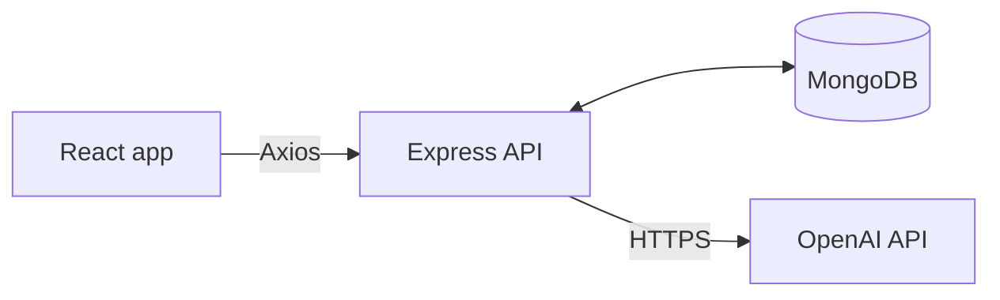

# The Scout

An Akinator-style football guessing game. Think of any footballer, and the Scout (an AI) asks up to 20 yes/no questions to work out who it is.

Built for Full Stack Decal, Project 2: APImagination.

## Features

- Answer the Scout's questions with Yes, No, Don't know, Probably or Probably not
- The Scout guesses when it's confident, and must guess by question 20
- Result page with every question and answer; if you stump the Scout, you can say who your player was
- The Scout's win/loss record on the home page
- Games are saved in the database, so refreshing mid-game loses nothing

## Tech stack

| Part | Tech |
|---|---|
| Frontend | React, TypeScript, Vite, React Router, Axios |
| Backend | Node.js, Express, TypeScript |
| Database | MongoDB with Mongoose |
| AI | OpenAI Responses API with Structured Outputs |

## How it works



1. The browser sends one of five fixed answers to the Express API.
2. The server checks it, saves it in MongoDB, rebuilds the question history and asks OpenAI for the next move.
3. OpenAI must reply with JSON in the shape `{ "action": "ask" | "guess", "text": "..." }`. On question 20 it can only guess.
4. The OpenAI API key stays on the server in `server/.env` and is never sent to the browser.

## Running it locally

You need Node.js 22+, MongoDB running on your machine, and (optionally) an OpenAI API key. Without a key, the server uses a simple built-in fake Scout so you can still play.

```bash
# Terminal 1: the API
cd server
cp .env.example .env    # then put your key in OPENAI_API_KEY
npm install
npm run dev             # http://localhost:3000

# Terminal 2: the website
cd client
npm install
npm run dev             # http://localhost:5173
```

## API

| Method | Path | What it does |
|---|---|---|
| POST | `/api/games` | Starts a game and returns the first question |
| GET | `/api/games/:id` | Returns a game with all its turns |
| POST | `/api/games/:id/answer` | Saves `{ answer }` and returns the next question, a guess or the result |
| POST | `/api/games/:id/reveal` | Saves `{ playerName }` after the player wins |
| GET | `/api/stats` | Returns the Scout's wins and losses |

## Project structure

```
client/          React app (pages: Home, Game, Result)
server/          Express API, Mongoose model and the OpenAI "Scout"
FIGMA DESIGN/    Figma mockups and the system design plan
html_files/      HTML exports of the designs
```
